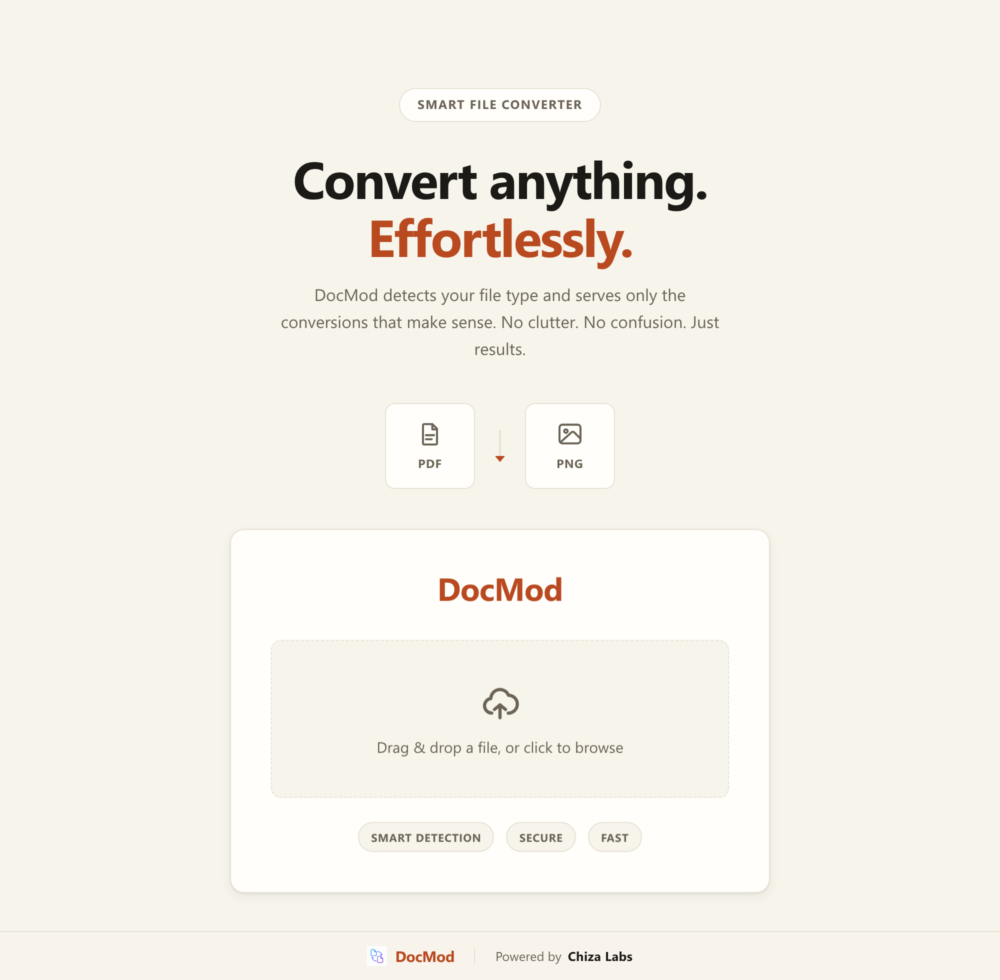

# DocMod

Smart file converter — drop a file, DocMod detects its type and only shows
the conversions that actually make sense for it. No format-matrix, no
clutter.



## What it does today

- **Images** — PNG, JPEG, WebP, AVIF, GIF, TIFF, BMP, convertible to each
  other (via [sharp](https://sharp.pixelplumbing.com/)).
- **Documents** — DOCX→HTML, TXT↔HTML, and PDF optimization, all in pure
  JS (via [mammoth](https://github.com/mimetype/mammoth.js) and
  [pdf-lib](https://pdf-lib.js.org/)).
- **Heavier document conversion** (DOCX/PPTX/XLSX→PDF via LibreOffice and
  Pandoc) is implemented in `backend/src/converters/`, but isn't live in
  the current deployment — see [Deployment](#deployment) below for why.

The backend detects which system binaries (`pandoc`, `soffice`) are
actually present at runtime and only registers the converters it can
support, so the app degrades gracefully instead of failing — see
`backend/src/utils/BinaryChecker.js` and `ConverterFactory.js`.

## Architecture

- `backend/src/converters/` — one class per conversion engine
  (`ImageConverter`, `PdfConverter`, `DocumentConverter`,
  `PandocConverter`, `LibreOfficeConverter`), all extending `BaseConverter`.
  Adding a new format means adding a new converter, not modifying existing
  ones.
- `ConverterFactory` — resolves a `(fromExt, toExt)` pair to whichever
  registered converter supports it, built dynamically from which binaries
  `BinaryChecker` finds on the host.
- `ConversionService` / `ConversionController` — orchestration and HTTP
  concerns are kept separate; the controller never touches a converter
  directly.
- The frontend (`frontend/src/`) is a small Vite + React app: drop a file,
  it's classified client-side, the backend reports which target formats
  are valid for that category, convert, and the response comes back as a
  file blob in the same request (no separate download step).

## Setup

### Backend
```bash
cd backend
cp .env.example .env
npm install
npm run dev        # http://localhost:3000
```

### Frontend
```bash
cd frontend
cp .env.example .env   # set VITE_API_URL to match the backend above
npm install
npm run dev             # http://localhost:5173
```

## Deployment

Both frontend and backend deploy to **Vercel**:
- Frontend: a standard Vite project (Root Directory: `frontend`).
- Backend: deploys as a Vercel serverless function (`backend/api/index.js`
  + `backend/vercel.json`; Root Directory: `backend`). Set `VITE_API_URL`
  on the frontend project to the backend's deployed URL + `/api`, and
  `FRONTEND_URL` on the backend project to the frontend's URL (for CORS).

`backend/Dockerfile` and `render.yaml` are also kept in the repo — they
install LibreOffice + Pandoc for the full document-conversion feature set,
but that needs a real container host with enough RAM, not a serverless
function. They're for a future paid-VM deployment, not the current live
one; Vercel's serverless runtime has neither of those binaries, so
`ConverterFactory` simply doesn't register those converters there.

## Non-JS dependencies (for the Docker/container path only)
- **Pandoc** and/or **LibreOffice** — DOCX/PPTX/XLSX→PDF and related
  conversions `BinaryChecker` detects and wires in automatically if
  present.

---
Powered by Chiza Labs.
